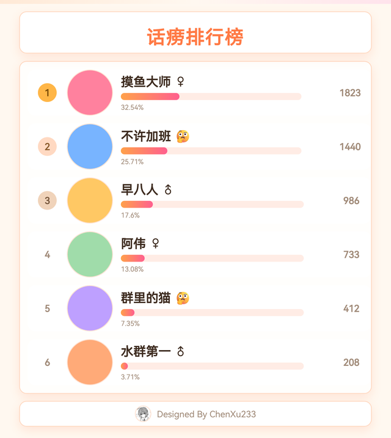
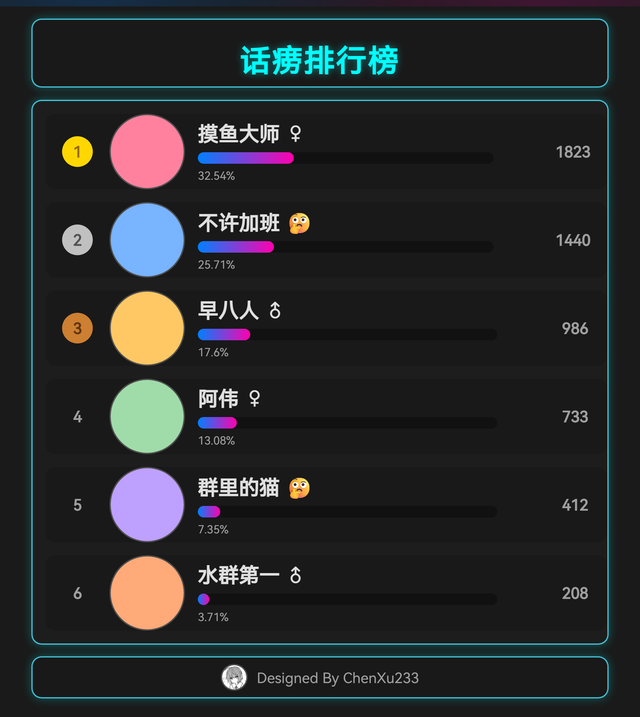
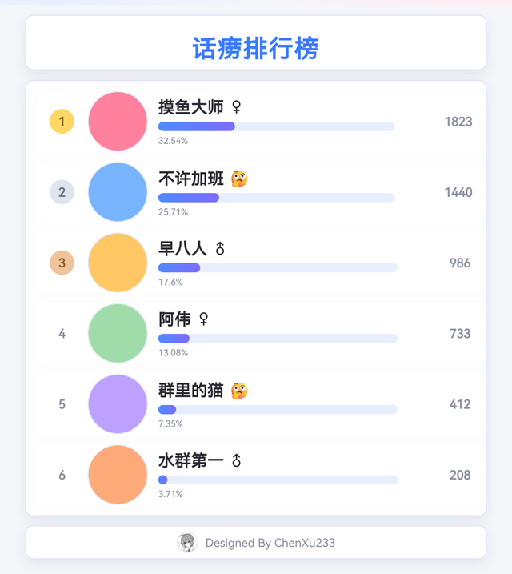
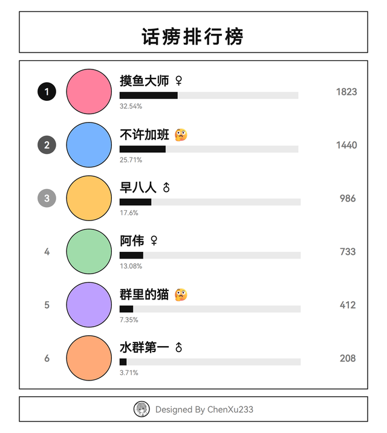
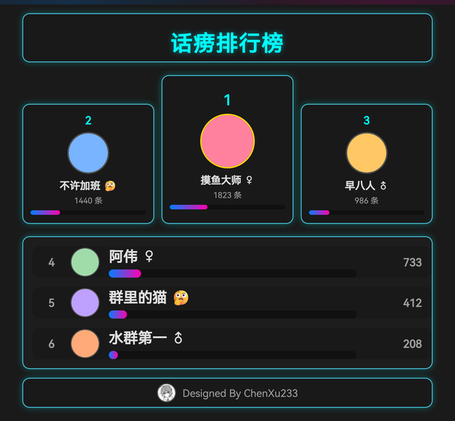
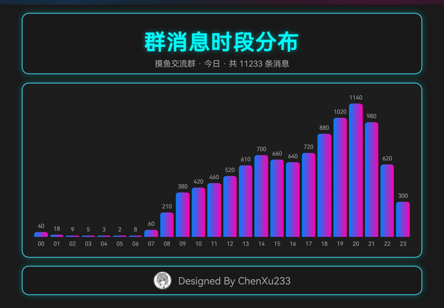
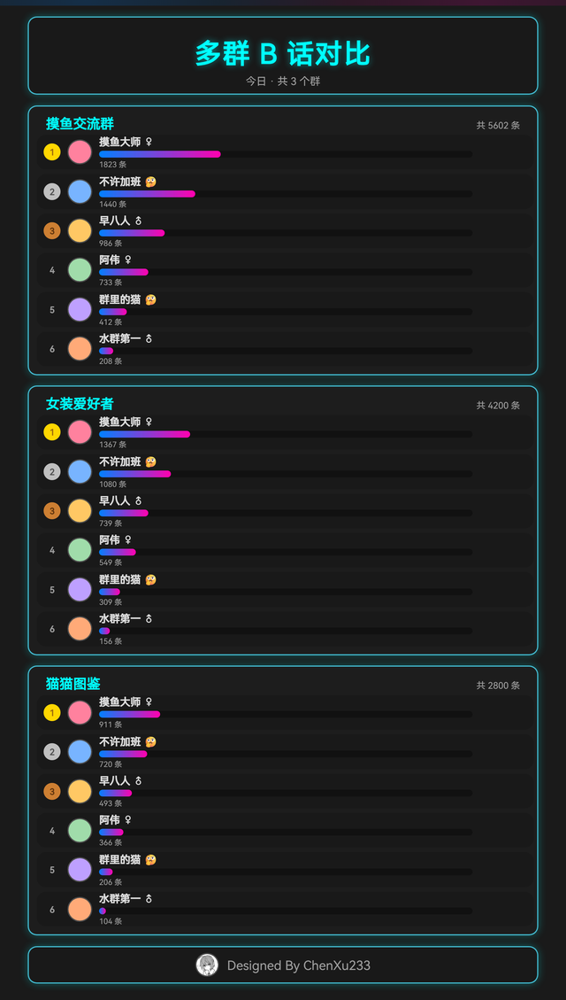
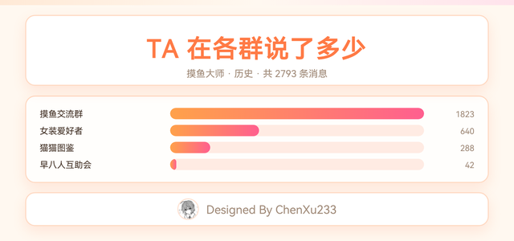

<div align="center">
  <a href="https://v2.nonebot.dev/store"></a>
  <br>
  <p></p>
</div>

<div align="center">

# 📃 话痨排行榜

nonebot-plugin-dialectlist

<p align="center">
  <a href="https://pypi.python.org/pypi/nonebot-plugin-dialectlist">
    
  </a>

  
  
  <a href="https://qm.qq.com/q/Yty2yc9Bee">
    
  </a>
</p>

[](https://wakatime.com/badge/user/114aee90-a5f9-49aa-b441-9eca7eebfda3/project/68aaa2a1-fb8a-4b00-bb66-ee67e8a3f3b0)

\>💬**看看群友们这些天在群里水了多少话**💬<

[📜 更新日志](./CHANGELOG/) · [🚀 Releases](https://github.com/ChenXu233/nonebot_plugin_dialectlist/releases)

</div>

## 💿 安装

通过`pip`或`nb`安装：

- 通过 pip 安装

```bash
pip install nonebot-plugin-dialectlist
```

- 通过 nb-cli 安装

```bash
nb plugin install nonebot-plugin-dialectlist
```

### ✅ 插件依赖于

1. [nonebot-plugin-chatrecorder](https://github.com/noneplugin/nonebot-plugin-chatrecorder) ————实现消息储存
2. [nonebot-plugin-orm](https://github.com/nonebot/nonebot-plugin-orm) ————数据库
3. [nonebot-plugin-uninfo](https://github.com/nonebot/nonebot-plugin-uninfo) ————跨平台会话信息
4. [nonebot-plugin-userinfo](https://github.com/noneplugin/nonebot-plugin-userinfo) ————获取用户信息
5. [nonebot-plugin-alconna](https://github.com/ArcletProject/nonebot-plugin-alconna) ————实现命令解析
6. [nonebot-plugin-send-anything-anywhere](https://github.com/felinae98/nonebot-plugin-send-anything-anywhere) ————实现多平台发送
7. [nonebot-plugin-htmlrender](https://github.com/nonebot/nonebot-plugin-htmlrender) ————渲染排行榜图片

**⚠ 注意** 若先前没有安装过`nonebot-plugin-chatrecorder`或者`nonebot-plugin-orm`，则会在启动时报错，请按报错的提示安装数据库！

> [!IMPORTANT]
> **关于 htmlrender 版本**：支持 `nonebot-plugin-htmlrender >= 0.6.6, < 0.9`。
>
> 3.4.0 起插件会在启动时检查渲染后端：检测到 0.8+ 但没配 `RENDER__PROVIDER`，
> 会自动按 `playwright` 处理（0.7 对应 `RENDER_BACKEND`），并在日志里提示一次。
> 想换后端就在 `.env` 里显式写上，插件不会覆盖你的配置：
>
> ```dotenv
> # htmlrender 0.8+
> RENDER__PROVIDER=playwright
> # htmlrender 0.7
> RENDER_BACKEND=playwright
> ```
>
> 模板的样式、字体和头像已全部内联成 data URI，所以 0.8 的本地文件访问限制不影响出图。
> 内置字体默认用 GB2312 一级常用字子集（约 480KB），生僻字回落到系统字体；
> 要完整字库设 `dialectlist__font=full`，想再快一点可以用 `system`。
> 首次渲染会自动安装 Chromium，也可以手动执行 `playwright install chromium`。
>
> 如果渲染真的失败了（比如浏览器没装好），群里会收到一句「图片渲染失败：…」的提示，
> 而不是毫无反应；完整排查步骤写在日志里。

## 🔄 从 2.x 升级

3.0 起插件不再使用数据库缓存，2.x 的迁移文件也一并移除了。如果升级后启动时报：

```
alembic.util.exc.CommandError: Can't locate revision identified by 'fb88e4d27eb8'
```

说明数据库的 `alembic_version` 表里还留着旧插件的版本号，执行一次即可：

```bash
nb orm stamp --purge
```

它会把版本表清空并标记到当前的迁移 head（**不执行任何迁移**），之后就能正常启动。

> [!NOTE]
> 2.6.x 的迁移文件本身有一条指向不存在的父迁移，会报 `KeyError: '60daff81fcdc'`，
> 升级到 3.1 后该文件已删除，不会再出现这个错误。

## ⚙ 配置

需要**提前配置**本插件所**依赖的插件**！

在 .env 中，可以添加以下配置项

```python
dialectlist__enabled: bool = True  # 全局总开关
dialectlist__get_num: int = 5  # 获取人数数量
dialectlist__suffix: bool = True  # 是否显示后缀
dialectlist__visualization: bool = True  # 是否可视化
dialectlist__show_text_rank: bool = True  # 是否显示文本排名
dialectlist__excluded_people: List[str] = []  # 排除的人的 QQ 号
dialectlist__use_user_info_cache: bool = True  # 是否使用用户信息缓存（10 秒 TTL）
dialectlist__aggregate_transmission: bool = False  # 是否聚合转发消息
dialectlist__timezone: Optional[str] = "Asia/Shanghai"  # 时区，影响统计时间
dialectlist__string_suffix: str = "统计花费时间：{timecost}秒"  # 消息格式后缀
dialectlist__template: str = "classic"  # 榜单模板（classic / podium / 自建的）
dialectlist__template_path: str = ""  # 老写法：直接指一个 .j2，填了就优先用它
dialectlist__theme: str = "warm"  # 配色：warm（默认）/ dark / light / minimal
dialectlist__layout: str = "list"  # 排版：list（竖排）/ grid（横排）
dialectlist__font: str = "subset"  # 内置字体：subset（常用字，默认）/ full（全字库）/ system（系统字体）
dialectlist__string_format: str = "第{index}名：\n{nickname},{chatdatanum}条消息\n"  # 消息格式
dialectlist__push_enabled: bool = False  # 是否开启定时推送
dialectlist__push_cron: str = "0 0 * * *"  # 默认推送时间（cron 5 段式）
dialectlist__push_period: str = "昨日"  # 默认统计区间
dialectlist__push_groups: Dict[str, dict] = {}  # 群号 -> 该群的推送配置
```

💭 也可以不进行配置，这将会使插件按照默认配置运行

> [!NOTE]
> 3.1.0 起模板变量有变化：`inline_css`（内联的样式表与字体）、`i.user_avatar_data_uri`（头像 data URI）。
> 插件不再向缓存目录写头像文件，也不再向模板传入 `cache_path` / `file_path`；自定义模板请改用新变量。

### ⚠ 注意！！

> 在旧版插件（2.0.0 以下）中，dialectlist 与后面的配置项只隔了一个下划线，若更新到新版本以后需要俩个下划线。

> 由于插件依赖 chatrecord 多次引入爆炸性修改，建议在遇到问题后优先尝试降级 chatrecord 插件

## ⏰ 定时推送

3.2.0 起支持按 cron 自动推送排行榜（默认关闭）。

```dotenv
DIALECTLIST__PUSH_ENABLED=true
DIALECTLIST__PUSH_CRON=0 0 * * *
DIALECTLIST__PUSH_PERIOD=昨日
# 群号 -> 该群配置，不写字段就用全局默认
DIALECTLIST__PUSH_GROUPS={"123456789": {}, "987654321": {"cron": "0 8 * * *", "min_messages": 10}}
```

`push_groups` 里每一项支持这些字段（都会覆盖全局值）：

| 字段 | 说明 | 默认 |
| :-- | :-- | :-- |
| `enabled` | 是否给这个群推送 | `true` |
| `cron` | 该群的推送时间，5 段式 cron | 用 `push_cron` |
| `period` | 统计区间，可选 今日/昨日/本周/上周/本月/上月/年度 | 用 `push_period` |
| `min_messages` | 区间内消息数少于这个值就不推 | `0`（不限制） |
| `min_members` | 群人数少于这个值就不推 | `0`（不限制） |
| `get_num` | 该群榜单展示人数 | 用 `get_num` |

几个注意点：

- 目前只支持 QQ 群（群号必须是数字），其他平台会跳过并打日志
- `min_members` 依赖适配器的 `get_group_info`，拿不到群信息时会跳过这项检查而不是不推
- 推送用的是 uninfo 缓存的昵称和头像，不会在半夜刷接口
- 时间按 `dialectlist__timezone` 解释

## 🛠 按群配置

3.3.0 起每个群可以有自己的配置，存在 `groups.json` 里，改完立即生效，不用重启。

路径由 localstore 决定（Windows 一般是 `%APPDATA%\nonebot2\nonebot_plugin_dialectlist\groups.json`），
发一次 `/B话榜配置`，最后一行会打印实际路径。

在群里用 `B话榜配置`（群主、管理员或 bot 主人才能用）：

```text
/B话榜配置 帮助          列出所有可配置项和例子
/B话榜配置               查看当前群的配置，带 * 的是单独改过的
/B话榜配置 开关 关        关掉这个群的排行榜（查询和推送都会停）
/B话榜配置 人数 3         只显示前 3 名
/B话榜配置 排除 123,456   统计时排除这些人
/B话榜配置 模板 podium    换这个群的模板
/B话榜配置 样式 浅色       换配色
/B话榜配置 布局 横排       换排版
/B话榜配置 推送 开        给这个群开定时推送
/B话榜配置 推送时间 0 8 * * *
/B话榜配置 推送区间 本周
/B话榜配置 重置           清空这个群的配置
/B话榜重载                重新读配置文件并刷新定时任务
```

可用的键（中英文都行）：

| 键 | 说明 |
| :-- | :-- |
| `开关` / `enabled` | 这个群是否允许查询和推送 |
| `模板` / `template` | 该群用哪套模板，见 [样式与模板](#-样式与模板) |
| `模板路径` / `template_path` | 直接指定模板文件的老写法 |
| `样式` / `theme` | 配色：暖阳（默认）/ 暗夜 / 浅色 / 简约 |
| `布局` / `layout` | 排版：竖排 / 横排 |
| `人数` / `get_num` | 榜单展示人数 |
| `图片` / `visualization` | 是否输出排行榜图片 |
| `文字` / `show_text_rank` | 是否输出文字榜单 |
| `后缀` / `suffix` | 是否显示统计耗时 |
| `排除` / `excluded_people` | 统计时排除的 QQ 号，逗号分隔，`清空` 表示取消 |
| `推送` / `push_enabled` | 这个群是否定时推送 |
| `推送时间` / `push_cron` | 推送用的 5 段式 cron |
| `推送区间` / `push_period` | 推送统计区间 |
| `推送阈值` / `push_min_messages` | 消息量下限 |
| `推送群人数` / `push_min_members` | 群人数下限 |
| `推送人数` / `push_get_num` | 推送榜单人数 |

`.env` 里的 `dialectlist__push_groups` 仍然有效，两者叠加时以群配置为准；直接改 `groups.json` 也会在下一次读取时生效（按 mtime 判断），改完想立刻刷新定时任务就发一次 `/B话榜重载`。

## 🎨 样式与模板

3.5.0 起，外观拆成三层：**模板**（结构）+ **样式**（配色）+ **排版**。三者互相独立，换样式不用碰模板，换模板也不用改代码。

### 效果

同一套模板，只换样式：

- **暖阳**（`warm`，默认）<br>
  
- **暗夜**（`dark`）<br>
  
- **浅色**（`light`）<br>
  
- **简约**（`minimal`）<br>
  
- **横排**（`layout=grid`）<br>
  
- **领奖台模板**（`template=podium`）<br>
  

### 样式和排版

榜单、分布图、多群对比、成员跨群**共用同一套外壳**（标题卡 + 内容 + 页脚），所以换一次配色，所有图一起变，不会出现「榜单是暗色、分布图是白底」这种事。

| 样式 | id | 长什么样 |
| :-- | :-- | :-- |
| 暖阳 | `warm` | 米色底 + 橙粉渐变，默认 |
| 暗夜 | `dark` | 霓虹描边 + 深色底 |
| 浅色 | `light` | 白底卡片，白天看不刺眼 |
| 简约 | `minimal` | 纯黑白，去掉发光和圆角 |

排版两种：`list`（一人一行，默认）和 `grid`（卡片横着铺开）。

```dotenv
DIALECTLIST__THEME=light
DIALECTLIST__LAYOUT=grid
```

群里也能改，改之前可以先看一眼效果：

```text
/B话榜样式                 列出所有样式和排版，附当前群用的
/B话榜样式 浅色             渲一张预览图
/B话榜样式 浅色 横排        样式和排版一起看
/B话榜配置 样式 浅色        这个群以后用浅色
/B话榜配置 布局 横排
```

### 自己做一个样式

样式是**目录**，丢进去就自动认出来，不用改代码、不用重启：

```text
<插件配置目录>/themes/
└── myskin/
    ├── meta.json    # 名字、说明、别名
    ├── base.css     # 变量和通用外观
    ├── rank.css     # 可选：这套样式对榜单的额外调整
    ├── chart.css    # 可选：对分布图 / 成员跨群
    └── compare.css  # 可选：对多群对比
```

```json
{
  "name": "深海",
  "description": "深蓝底 + 橙字",
  "aliases": ["蓝", "night-blue"]
}
```

`base.css` 把变量填上就能用，其余自动对齐：

```css
:root {
    --bg: #0b1b2b;
    --fg: #e6f0ff;
    --muted: #7f95ad;
    --accent: #ffb648;
    --card-bg: rgba(12, 35, 58, 0.9);
    --panel-bg: rgba(10, 30, 52, 0.9);
    --card-border: #1f4b7a;
    --card-glow: 0 0 15px rgba(31, 75, 122, 0.6);
    --title-glow: none;
    --avatar-border: #1f4b7a;
    --track: rgba(0, 0, 0, 0.35);
    --track-radius: 999px;
    --bar-fill: linear-gradient(90deg, #ffb648, #ff7a45);
    --chart-bar-radius: 6px 6px 0 0;
    --radius: 1rem;
    --medal-1-bg: gold;
    --medal-1-fg: #9a690e;
    --medal-2-bg: silver;
    --medal-2-fg: #505050;
    --medal-3-bg: #cd7f32;
    --medal-3-fg: #5f340e;
}
```

**没写的部分一律回落到默认样式（暖阳）**：

- 只写 `base.css`，分布图和多群对比就按默认样式那套画，不会变成裸 HTML
- 只写 `chart.css` 不写 `base.css`，变量也照默认来，只改图表那几行
- 排版同理：`layouts/<名字>/layout.css`，没写就是竖排

模板和样式的区别：**模板管结构**（一行一行怎么排），**样式管颜色和形态**。两者随便组合，4 套样式 × 2 种排版 × N 个模板。


### 模板包

模板是一个**目录**，不是单个 `.j2`。自己做的模板丢进插件配置目录就能用：

```text
<插件配置目录>/templates/
└── myskin/
    ├── rank_template.j2   # 必须
    ├── meta.json          # 可选：名字、说明、作者
    └── extra.css          # 可选：模板自己的样式，配色照样跟着主题走
```

```json
{
  "name": "我的皮肤",
  "description": "长条卡片 + 大数字",
  "author": "某人"
}
```

拷进去就生效，不用重启：

```text
/B话榜模板                列出所有模板（内置的 + 你自己的）
/B话榜模板 podium         渲一张预览图
/B话榜配置 模板 podium     这个群以后用它
/今日B话榜 -m podium      就这一次用它
```

内置两套：`classic`（一人一行）和 `podium`（前三名上台，其余收成紧凑列表）。

想整套自己写样式，就在模板目录里放 `css/style.css`——放了它就不再套主题，整份样式由你决定。
字体和图片照样会被内联成 data URI，不用管 htmlrender 的本地文件访问限制。

内置字体为了出图速度只保留 GB2312 一级常用字（生僻字用系统字体兜底）；
`dialectlist__font` 可选 `subset`（默认）/ `full`（完整字库）/ `system`（不内联字体）。

`template_path` 老写法（直接指一个 `.j2` 文件）仍然兼容，指向的文件不存在会自动退回按模板名选。

## 📊 更多查询

除了「某个群某个时间段的榜单」，还能这么查（都是 3.5.0 加的）：

### 分布图

```text
/B话榜分布                今天，按小时
/B话榜分布 本月 星期      这个月，按星期几
/B话榜分布 本周 -g 123456 指定群
/B话榜分布 今日 -k 女装   只看带关键词的消息
```

- 按小时（`/B话榜分布`）<br>
  

### 多群对比

```text
/B话榜对比 123456 789012           今日，两个群放一张图里
/B话榜对比 123456 789012 111213 -t 本周
/B话榜对比 123456 789012 -k 女装
```

- 三个群一起对比（`/B话榜对比 111 222 333`）<br>
  

一次最多 6 个群；群一多会自动少列几个人，免得图长到没法看。

### 某个成员在几个群里的总量

```text
/B话榜成员 @某人
/B话榜成员 12345678 本月
```

- TA 在各群的发言量<br>
  

按群列 TA 说了多少，最后给总数。默认统计全部历史，加时间类型就是指定区间。

## 🗨 命令

**！！注意！！**
新版本指令调用方式改变，改为更易理解也更好打的 B 话榜。
同时也可以用类似 `/今日废话榜` 的方式（只要改前面的就好了）（算是给 [盘古之白](https://github.com/vinta/pangu.js) 风格爱好者的福利吧？）

### 🎨 一般用法

#### 帮助

-`/B话榜帮助` ————列出所有用法和配置项（别名：`话痨榜帮助`、`排行榜帮助`）

-`/B话榜 帮助` ————同上

#### B 话榜

-`/B 话榜` ————看看有史以来（机器人存在以来）群友们发了多少消息！ （好像没写）

-`/今日 B 话榜` ————看看今天的群友发了多少消息！

-`/昨日 B 话榜` ————看看昨天的群友发了多少消息！

-`/本周 B 话榜` ————看看本周的群友发了多少消息！

-`/上周 B 话榜` ————看看上周的群友发了多少消息！

-`/本月 B 话榜` ————看看这个月的群友发了多少消息！

-`/年度 B 话榜` ————看看今年的群友发了多少消息！

-`/历史 B 话榜` ————看看历史上（机器人存在以来）的群友发了多少消息！

#### 看看 B 话（kkb）

-`/看看 B 话 [@某人|QQ 号]` ————看看这个 b 人在这个 b 群发了多少 b 话！

### 🚀 进阶用法

#### B 话榜

`/{时间类型（今日|年度）?}{B 话榜|废话榜} {时间类型？} {ISO8601 格式时间 ?} {群号} {关键词}`

如：`/B 话榜 历史 2024-01-01~2024-01-02 12345678 女装`

也可以 `/{时间类型（今日|年度）?}{B 话榜|废话榜} {时间类型？} {ISO8601 格式时间 ?} -g {群号} -k {关键词}`

以下调用方法均合法：

`/今日 B 话榜 -g 12345678 -k 女装`
`/昨日 B 话榜 -k 女装`
`/本周 B 话榜 -g 12345678`

#### 看看 B 话

`/看看 B 话 {@|QQ 号} {群号？} {关键词？}`

以下调用方法均合法：

`/kkb 114514 1919810 ♂`
`/kkb @man -k ♂`

> [!IMPORTANT]
> 关键词按“包含”匹配（不区分大小写的子串匹配），**不支持正则表达式**；输入中的 `%`、`_` 会按普通字符处理。

> [!NOTE]
> 3.0.2 起移除了从未生效的 `font`（字体固定使用内置字体）与 `excluded_self`（统计本就只算收到的消息）两项配置。

## 💪 目前支持的平台

|    平台     | 是否经过测试 | 是否能够正常工作 |     测试环境      |
| :---------: | :----------: | :--------------: | :---------------: |
|   Onebot    |      ✅      |        ✅        | NapCat + Window11 |
|    飞书     |      ❌      |        ❓        |        🤔         |
|     Red     |      ❌      |        ❓        |        🤔         |
|    DoDo     |      ❌      |        ❓        |        🤔         |
|    Mirai    |      ❌      |        ❓        |        🤔         |
|   开黑啦    |      ❌      |        ❓        |        🤔         |
|   Kritor    |      ❌      |        ❓        |        🤔         |
|   Ntchat    |      ❌      |        ❓        |        🤔         |
|   Satori    |      ❌      |        ❓        |        🤔         |
|  Telegram   |      ❌      |        ❓        |        🤔         |
|   Discord   |      ❌      |        ❓        |        🤔         |
|  Tailchat   |      ❌      |        ❓        |        🤔         |
| QQ 官方接口 |      ❌      |        ❓        |        🤔         |
| Rocket.Chat |      ❌      |        ❓        |        🤔         |

- 如果你测试过能够使用，请在 Issue 中指出

## 📦 另外

### 😳 加入作者的 BUG 反馈群 ~~（🥵 女装粉丝群）~~

[群连接](https://qm.qq.com/q/Yty2yc9Bee)

<details>
<summary>群二维码 点我展开</summary>


</details>


### 💕 感谢

本插件的**init**.py 中的处理函数参考了词云中的方法 ~~（其实大部分都是 Ctrl+C Ctr+V）~~

[nonebot-plugin-wordcloud](https://github.com/he0119/nonebot-plugin-wordcloud)

感谢以下开发者作出的贡献：

<a href="https://github.com/ChenXu233/nonebot_plugin_dialectlist/graphs/contributors">
  
</a>
  
### 🎀TODO

- [x] 适配全平台

- [x] 更好看的图片渲染

- [x] 添加一些全新的可配置项
- [x] 尝试利用 jinja2 模板引擎制作可视化图片

- [x] 私聊的查询（超级用户可以任意查询群聊的信息）一半完成

- [x] 特殊的储存方案优化消息统计

- [x] 查询带某关键词的消息量

- [x] 合并转发

- [x] 多套配色与排版（暗夜 / 浅色 / 简约 / 暖阳，竖排 / 横排）

- [x] 多模板支持（模板包 + 预览 + 按群切换）

- [x] 更多查询方式（时段分布、星期分布、多群对比、成员跨群）

待补充。.....

### 👾 题外话

~~整个项目快被我写成屎山了~~
